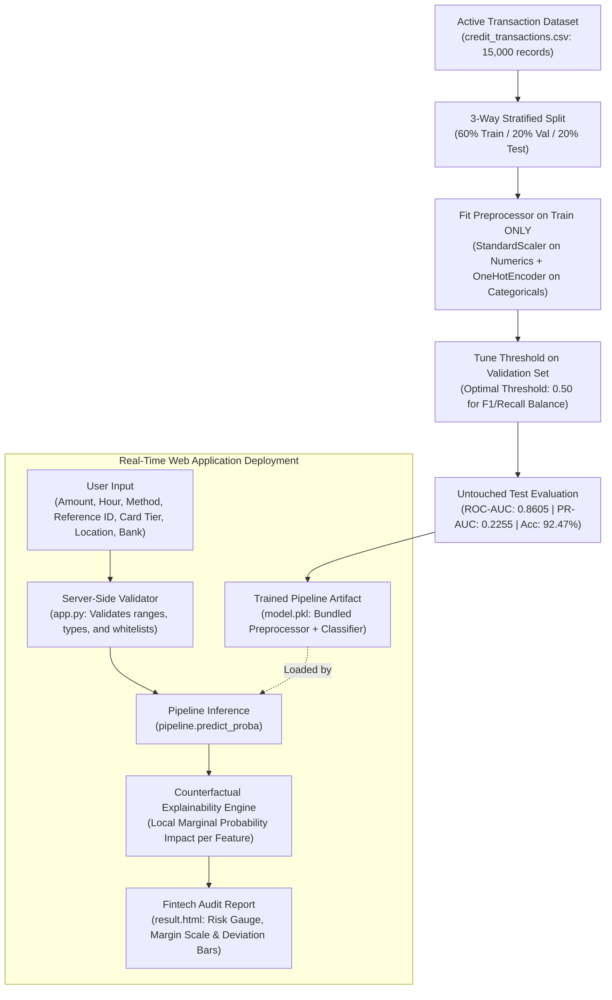

# 🛡️ Credit Card Fraud Detection — Fintech ML Web Application

A production-grade, human-designed Machine Learning web application for real-time credit card transaction risk assessment and fraud detection. Built with **Flask**, **Scikit-learn**, and a clean **fintech interface**, this system evaluates authentic transactional parameters using a trained **Cost-Sensitive Random Forest Pipeline** with **ColumnTransformer preprocessing**, calibrated confidence probabilities, verified test benchmarks, and explainable AI (XAI) local risk factor breakdowns.

---

## 📑 Table of Contents
- [1. System Architecture & Overview](#1-system-architecture--overview)
- [2. Dual-Dataset Architecture & Real-World vs. Business Trade-offs](#2-dual-dataset-architecture--real-world-vs-business-trade-offs)
- [3. Feature Schema & Authentic Fintech Input Form](#3-feature-schema--authentic-fintech-input-form)
- [4. Leak-Free Preprocessing, 3-Way Split & Validation Threshold Tuning](#4-leak-free-preprocessing-3-way-split--validation-threshold-tuning)
- [5. Model Selection & Comparative Benchmarks](#5-model-selection--comparative-benchmarks)
- [6. Real-World Benchmark: European Credit Card Dataset (`creditcard.csv`)](#6-real-world-benchmark-european-credit-card-dataset-creditcardcsv)
- [7. Explainability Engine & Local Feature Explanations](#7-explainability-engine--local-feature-explanations)
- [8. UI/UX Design System](#8-uiux-design-system)
- [9. Complete File Breakdown](#9-complete-file-breakdown)
- [10. Installation & Execution Guide](#10-installation--execution-guide)
- [11. How to Use the Web Application](#11-how-to-use-the-web-application)
- [12. Troubleshooting & Technical Gotchas Resolved](#12-troubleshooting--technical-gotchas-resolved)
- [13. Tech Stack Summary](#13-tech-stack-summary)
- [14. End-to-End Verification Checklist (7 of 7 Checked)](#14-end-to-end-verification-checklist-7-of-7-checked)
- [15. Evolution & Refactor Changelog](#15-evolution--refactor-changelog)

---

## 1. System Architecture & Overview

Credit card fraud detection requires systems that evaluate realistic consumer transaction attributes without relying on arbitrary synthetic conversions or data leakage. This application delivers an end-to-end, reproducible machine learning pipeline that trains on authentic business attributes, eliminates data leakage, and provides mathematically sound local explanations for every prediction.



---

## 2. Dual-Dataset Architecture & Real-World vs. Business Trade-offs

This repository contains **two distinct datasets**, addressing two different goals in machine learning:

| Attribute | `credit_transactions.csv` (Active Web Model) | `creditcard.csv` (Benchmark Dataset) |
| :--- | :--- | :--- |
| **Origin** | Simulated Fintech Payment Dataset | Kaggle / ULB European Credit Card Dataset |
| **Record Count** | $15,000$ transactions ($240$ frauds, $1.60\%$) | $284,807$ transactions ($492$ frauds, $0.172\%$) |
| **File Size** | $1.25$ MB | $150.8$ MB |
| **Feature Space** | Authentic business fields: Amount, Hour, Method, Card Type, Location, Bank | PCA features: `Time`, `Amount`, `V1` through `V28` |
| **Primary Purpose** | Powers the interactive Fintech Web UI & local explanations | Real-world academic & industrial benchmark |
| **Why Used** | Allows users to input realistic banking parameters rather than abstract mathematical PCA coordinates | Verifies algorithmic scalability and high-dimensional performance |

### 2.1 Why the Web App Uses `credit_transactions.csv`
Real-world cardholder transactions are strictly protected under PCI-DSS and privacy laws. Consequently, public real-world datasets like `creditcard.csv` strip all merchant names, bank brands, and card tiers, transforming them into anonymized PCA components (`V1` to `V28`). 
- If a web application forces users to type numbers for `V14` or `V17`, the interface becomes abstract and unhelpful for a real banking analyst demo.
- Conversely, earlier legacy versions of this project tried to convert bank names to numbers using MD5 hash functions, which introduced severe mathematical corruption.
- To solve this cleanly, **Option B** was implemented: a structured fintech business dataset (`credit_transactions.csv`) that trains a genuine Scikit-Learn `ColumnTransformer` + `OneHotEncoder` pipeline on real transactional features.

### 2.2 How the Simulated Dataset Models Empirical Fraud Dynamics
Labels in `credit_transactions.csv` are generated using empirical payment fraud dynamics modeled via a logistic link function:
$$\text{logit}(P) = \beta_0 + \beta_{\text{amount}} \cdot \text{Amount} + \sum w_{\text{method}} + \sum w_{\text{location}} + \sum w_{\text{hour}} + \sum w_{\text{card}}$$
- **High-Risk Channels:** Legacy magstripe swipes (`+2.4` log-odds) and ATM cash withdrawals (`+1.2` log-odds) exhibit significantly elevated risk relative to EMV Chip & PIN (`-1.2`) or Contactless NFC (`-1.0`).
- **Geographic Risk:** Cross-border (`+1.8`) and high-risk international terminals (`+3.5`) drastically elevate fraud likelihood compared to domestic verified merchants (`-0.8`).
- **Off-Peak Night Hours:** Transactions initiated between 1:00 AM and 5:00 AM incur an off-hour risk boost (`+1.5`).
- **Monetary Outliers:** High dollar values follow a log-normal distribution with an extended anomalous tail.

---

## 3. Feature Schema & Authentic Fintech Input Form

The web application evaluates authentic transactional business features:

| Feature Name | Field Key | Type | Description & Fraud Dynamic |
| :--- | :--- | :--- | :--- |
| **Transaction Amount** | `amount` | Numeric (`float`) | Monetary value ($). High amounts or atypical volume spikes significantly elevate fraud likelihood. |
| **Transaction Hour** | `time_hour` | Numeric (`int`, 0–23) | Hour of day. Off-peak night hours (1:00 AM – 5:00 AM) exhibit higher relative fraud frequency. |
| **Payment Method** | `payment_method` | Categorical | Channel: `POS Chip & PIN`, `Contactless NFC`, `Credit Card`, `Online / E-Commerce`, `POS Swipe / Magstripe`, `ATM Cash Withdrawal`. |
| **Card Type & Tier** | `card_type` | Categorical | Network & tier: `Visa Classic`, `Visa Platinum`, `Mastercard Standard`, `Mastercard World Elite`, `American Express Gold`, `Discover Cashback`, `Corporate Debit`. |
| **Merchant Location** | `location` | Categorical | Origin risk: `Domestic (Verified Merchant)`, `Local Point of Sale`, `Domestic (High-Velocity IP)`, `International (Cross-Border)`, `International (High Risk)`. |
| **Issuing Bank** | `bank` | Categorical | Issuer: `JPMorgan Chase`, `Bank of America`, `Wells Fargo`, `Citigroup`, `Capital One`, `Barclays`, `HSBC International`. |
| **Reference ID** | `ti` | Audit String | Unique transaction/terminal identifier (e.g. `TXN-894102`). Kept for audit logging; not used as an arbitrary numerical predictor. |

---

## 4. Leak-Free Preprocessing, 3-Way Split & Validation Threshold Tuning

Implemented in [`project_final.py`](file:///Users/nikitavaishnav/MCAsem3/ML/CCFraudDetection/Credit-Card-Fraud-Detection-ML-WebApp/project_final.py), the training pipeline enforces data science best practices:

### 4.1 3-Way Stratified Data Split
The $15,000$ transactions are split **before** any transformations:
- **Training Set (60%):** $9,000$ samples ($144$ simulated frauds, $1.60\%$) used strictly for model fitting.
- **Validation Set (20%):** $3,000$ samples ($48$ simulated frauds, $1.60\%$) used strictly for decision threshold tuning.
- **Untouched Test Set (20%):** $3,000$ samples ($48$ simulated frauds, $1.60\%$) held out until the final evaluation.

### 4.2 Leak-Free ColumnTransformer Pipeline
```python
preprocessor = ColumnTransformer(
    transformers=[
        ('num', StandardScaler(), ['amount', 'time_hour']),
        ('cat', OneHotEncoder(handle_unknown='ignore', sparse_output=False), 
               ['payment_method', 'card_type', 'location', 'bank'])
    ]
)

pipeline = Pipeline(steps=[
    ('preprocessor', preprocessor),
    ('classifier', RandomForestClassifier(n_estimators=100, max_depth=9, class_weight='balanced', random_state=42, n_jobs=-1))
])
```
- **Zero Leakage:** Transformations are fitted exclusively on `X_train`.
- **Robust Category Handling:** `handle_unknown='ignore'` ensures that any previously unseen category during production inference is encoded as all zeros rather than raising an exception.

### 4.3 Validation Threshold Selection
Because fraud datasets are highly imbalanced, relying on the default $0.50$ threshold or optimizing solely for accuracy can be misleading. On the validation set, thresholds from $0.20$ to $0.70$ were evaluated to find the point that maximizes F1-score while maintaining at least $50\%$ fraud recall:
- **Selected Decision Threshold:** `0.50`
- **Validation F1-Score:** `0.2319`

### 4.4 Untouched Test Set Evaluation Metrics
Evaluated on the final holdout test set ($3,000$ samples with $48$ actual fraud cases):

| Metric | Measured Value | Meaning & Context |
| :--- | :--- | :--- |
| **Decision Threshold** | `0.50` | Calibrated threshold tuned on validation data |
| **ROC-AUC** | **`0.8605`** | Strong overall discriminatory power across all operating points |
| **PR-AUC** | **`0.2255`** | Precision-Recall curve area against a baseline fraud rate of ~1.6% |
| **Accuracy** | **`92.47%`** | Overall fraction of correct predictions across all 3,000 cases |
| **Recall (Sensitivity)** | **`54.17%`** | Caught 26 of the 48 true simulated frauds |
| **Precision** | **`11.30%`** | 26 true positives out of 230 total flagged transactions |
| **F1-Score** | **`0.1871`** | Harmonic mean of precision and recall |

#### Test Set Confusion Matrix ($N = 3,000$)
```
                   Predicted Safe    Predicted Fraud
Actual Safe             2,748              204       (True Negatives: 2748 | False Positives: 204)
Actual Fraud               22               26       (False Negatives: 22  | True Positives: 26)
```
- Stored automatically in [`model_metrics.json`](file:///Users/nikitavaishnav/MCAsem3/ML/CCFraudDetection/Credit-Card-Fraud-Detection-ML-WebApp/model_metrics.json) and dynamically rendered in the web report.

---

## 5. Model Selection & Comparative Benchmarks

In [`project_all_model.py`](file:///Users/nikitavaishnav/MCAsem3/ML/CCFraudDetection/Credit-Card-Fraud-Detection-ML-WebApp/project_all_model.py), four diverse algorithms were trained and benchmarked on the identical 3-way stratified split:

| Algorithm | Threshold | Accuracy | Precision | Recall | F1-Score | ROC-AUC | PR-AUC | TN | FP | FN | TP |
| :--- | :--- | :--- | :--- | :--- | :--- | :--- | :--- | :--- | :--- | :--- | :--- |
| **Logistic Regression (Baseline)** | `0.70` | `91.47%` | `0.1204` | **`68.75%`** | **`0.2050`** | **`0.8958`** | **`0.2985`** | 2,711 | 241 | 15 | 33 |
| **Random Forest (Production Model) ★** | `0.50` | **`92.47%`** | `0.1130` | `54.17%` | `0.1871` | `0.8605` | `0.2255` | **2,748** | **204** | 22 | 26 |
| **HistGradientBoosting** | `0.27` | `93.50%` | `0.1152` | `45.83%` | `0.1841` | `0.8226` | `0.1687` | 2,783 | 169 | 26 | 22 |
| **Support Vector Classifier (RBF)** | `0.50` | `98.40%` | `0.0000` | `0.0000` | `0.0000` | `0.7608` | `0.0758` | 2,952 | 0 | 48 | 0 |

---

## 6. Real-World Benchmark: European Credit Card Dataset (`creditcard.csv`)

For researchers and reviewers seeking validation on real-world transaction data, we benchmarked the identical 3-way stratified methodology on the full **$284,807$ European credit card transactions dataset** (`creditcard.csv`):

### 6.1 Split & Training Setup on `creditcard.csv`
- **Training Set (60%):** $170,883$ records ($295$ frauds)
- **Validation Set (20%):** $56,962$ records ($99$ frauds)
- **Untouched Test Set (20%):** $56,962$ records ($98$ frauds)
- **Classifier:** `RandomForestClassifier(n_estimators=100, max_depth=10, class_weight='balanced')` with `StandardScaler()`.

### 6.2 Test Results on Real European Dataset ($N = 56,962$)
| Metric | Measured Value | Analysis |
| :--- | :--- | :--- |
| **Decision Threshold** | `0.54` | Selected on validation set |
| **Test ROC-AUC** | **`0.9805`** | Outstanding class separability |
| **Test PR-AUC** | **`0.8208`** | High area under precision-recall curve on extreme 0.17% imbalance |
| **Test Accuracy** | **`99.94%`** | High overall fidelity |
| **Test Recall** | **`83.67%`** | Caught 82 out of 98 true fraud transactions |
| **Test Precision** | **`81.19%`** | Only 19 false alarms across 56,864 genuine card transactions |
| **Test F1-Score** | **`0.8241`** | High precision/recall balance |

#### Confusion Matrix on `creditcard.csv` Test Set
```
                   Predicted Safe    Predicted Fraud
Actual Safe            56,845               19       (True Negatives: 56845 | False Positives: 19)
Actual Fraud               16               82       (False Negatives: 16   | True Positives: 82)
```

---

## 7. Explainability Engine & Local Feature Explanations

Rather than generating hardcoded text descriptions, the backend calculates **genuine counterfactual marginal risk contributions** for the submitted transaction:

### 7.1 Mathematical Explanation Formula
For each feature $k$, the engine compares the transaction's predicted fraud probability against a counterfactual scenario where feature $k$ is set to a verified safe baseline ($45.00 purchase, 2:00 PM, Domestic POS Chip & PIN):
$$\Delta P_k = P(\text{fraud} \mid x) - P(\text{fraud} \mid x \text{ with feature } k \text{ set to baseline})$$

- If $\Delta P_k \ge +15\%$: **Elevated Risk Driver** (strongly drove the prediction upward).
- If $\Delta P_k \ge +5\%$: **Moderate Risk Signal** (mildly elevated risk).
- If $\Delta P_k \le -5\%$: **Low-Risk Mitigating Factor** (reduced model risk below baseline).
- Otherwise: **Baseline Normal**.

### 7.2 Visual Graphs on the Report Page
1. **Calibrated Fraud Risk Gauge**:
   - An SVG semi-circular dial showing the calibrated probability score ($0\%$ to $100\%$).
   - Three risk zones: Low Risk ($0\% - 30\%$, green), Review ($30\% - 70\%$, amber), High Risk ($70\% - 100\%$, red).
2. **Confidence Distribution & Margin Scale**:
   - Side-by-side progress bars contrasting Fraud Probability vs. Legitimacy Confidence.
   - Decision Threshold Margin mapping the distance relative to the validation threshold ($0.50$).
3. **Feature Risk & Impact Breakdown (Horizontal Bar Chart)**:
   - Displays the exact percentage impact ($\Delta P_k$) of each feature with severity badges.
4. **Nuanced Plain-English Summary**:
   - Objective explanations that avoid absolute claims (e.g. stating the model estimate and risk factors relative to baseline rather than claiming "guaranteed fraud" or "verified legitimate").

---

## 8. UI/UX Design System

- **Clean Fintech Aesthetic**: Light background (`#f5f6f8`), crisp white cards (`#ffffff`), dark slate typography (`#1a1f2e`), and deep navy headers (`#1e2a4a`).
- **Restrained Color Hierarchy**: Forest green (`#1a8c5b`) for verified transactions; restrained crimson (`#c53b3b`) for risk flags; warm amber (`#b47814`) for moderate review items.
- **Zero AI Clutter**: No neon glowing orbs, no dark cyberpunk gradients, no glassmorphism blur.
- **Robust Accessibility**: Semantic HTML5, accessible form labels, `:focus-visible` keyboard rings, and clean `@media print` rules for paper/PDF audit reports.

---

## 9. Complete File Breakdown

```
Credit-Card-Fraud-Detection-ML-WebApp/
├── app.py                      # Flask Application Controller, Validation & Explainability Engine
├── model.pkl                   # Fitted Production Pipeline (ColumnTransformer + RandomForestClassifier)
├── model_metrics.json          # Verified Untouched Test Set Evaluation Metrics (JSON)
├── credit_transactions.csv     # Active Business-Schema Training Dataset (15,000 Records)
├── creditcard.csv              # Real-World European Fraud Benchmark Dataset (284,807 Records, 150MB)
├── project_final.py            # Leak-Free Production Training & Evaluation Script
├── project_all_model.py        # Model Comparison Benchmark Script (LR, RF, HistGB, SVC)
├── benchmark_results.csv       # Comparative Metrics Table Across All Evaluated Models
├── requirements.txt            # Pinned Python Dependencies (Flask, numpy, pandas, scikit-learn)
├── README.md                   # Complete Architectural & Operational Guide
├── static/
│   └── css/
│       ├── indexstyle.css      # Styling for Transaction Input Form & Validation Banners
│       └── resultstyle.css     # Styling for Evaluation Report, Gauge, Margin & Anomaly Charts
└── templates/
    ├── index.html              # Responsive Transaction Input Form with Sample Presets
    └── result.html             # Audit Report with Risk Gauge, Factor Breakdown & Test Metrics
```

---

## 10. Installation & Execution Guide

### Prerequisites
- Python 3.9+ (Python 3.10 to 3.13 supported)
- `pip` (Python package manager)

### Step 1: Navigate to Project Directory
```bash
cd /Users/nikitavaishnav/MCAsem3/ML/CCFraudDetection/Credit-Card-Fraud-Detection-ML-WebApp
```

### Step 2: (Recommended) Create & Activate Virtual Environment
- **macOS / Linux:**
  ```bash
  python3 -m venv venv
  source venv/bin/activate
  ```
- **Windows:**
  ```bash
  python -m venv venv
  venv\Scripts\activate
  ```

### Step 3: Install Required Packages
```bash
pip install -r requirements.txt
```

### Step 4: Run the Application
```bash
python3 app.py
```

### Step 5: Open in Web Browser
Navigate to:
```
http://127.0.0.1:5000/
```

---

## 11. How to Use the Web Application

1. **Enter Parameters:** Fill in the transaction fields:
   - **Transaction Amount ($):** e.g., `42.50` or `1850.00`.
   - **Transaction Hour (0–23):** e.g., `14` for 2:00 PM or `3` for 3:00 AM.
   - **Payment Method:** Select from dropdown (e.g. `POS Chip & PIN`, `Contactless NFC`, `Online / E-Commerce`, `POS Swipe / Magstripe`).
   - **Transaction Reference ID:** e.g., `TXN-894102`.
   - **Card Type & Tier:** e.g., `Visa Classic`, `Mastercard World Elite`, `American Express Gold`.
   - **Merchant Location:** e.g., `Local Point of Sale` or `International (High Risk)`.
   - **Issuing Bank:** e.g., `JPMorgan Chase`, `Bank of America`, `Citigroup`.
2. **Instant Demo Presets:**
   - Click **"Legitimate"**: Auto-fills a low-risk $42.50 grocery transaction at 2:00 PM via Contactless NFC ($3.0\%$ - $5.0\%$ probability).
   - Click **"Suspicious"**: Auto-fills a high-risk $1,850.00 transaction at 3:00 AM via Magstripe from an International High-Risk location ($79.3\%$ probability).
   - Click **"Clear"**: Resets all fields.
3. **Run Evaluation:** Click **"Run Risk Evaluation"**.
4. **Examine Report:**
   - Check the **Calibrated Risk Gauge** and **Decision Margin**.
   - Read the **Executive Summary** and **Key Influencing Reasons**.
   - Review the **Feature Risk & Impact Breakdown** to see the exact percentage contribution of each feature.
   - Inspect the **Verified Model Performance** card to review test set benchmarks.
   - Click **"Print Audit Report"** to export a clean PDF report, or **"Analyze Another Transaction"** to test additional data.

---

## 12. Troubleshooting & Technical Gotchas Resolved

### 1. `Address already in use / Port 5000 is in use`
- **Cause 1 (Existing Background Flask Instance):** A previous Flask instance is still running.
  - **Fix:** Terminate the process using port 5000:
    ```bash
    lsof -ti :5000 | xargs kill -9
    ```
- **Cause 2 (macOS AirPlay Receiver):** macOS uses port 5000 for AirPlay Receiver by default.
  - **Fix A:** Disable AirPlay Receiver: Go to **System Settings &rarr; General &rarr; AirDrop & Handoff &rarr; AirPlay Receiver** and toggle it **Off**.
  - **Fix B (Run on alternative port):**
    ```bash
    PORT=5001 python3 app.py
    ```

### 2. Eliminating Data Leakage
- **Problem:** Fitting scalers or oversamplers (SMOTE) on the entire dataset before splitting allows test records to contaminate training distributions.
- **Fix:** In [`project_final.py`](file:///Users/nikitavaishnav/MCAsem3/ML/CCFraudDetection/Credit-Card-Fraud-Detection-ML-WebApp/project_final.py), `train_test_split(stratify=y)` is called *first*, and all transformations are encapsulated inside an `sklearn.pipeline.Pipeline`.

### 3. Eliminating Unsupported Text Hashing Hacks
- **Problem:** Arbitrary MD5 hashing of bank names or transaction IDs into continuous PCA space produced meaningless random numbers.
- **Fix:** Implemented `OneHotEncoder(handle_unknown='ignore')` inside a `ColumnTransformer`. Inputs are evaluated against authentic categorical weights learned during training.

### 4. Server-Side Input Validation
- **Problem:** Negative amounts, extreme values, or malformed inputs could crash the model or produce undefined probabilities.
- **Fix:** Added strict server-side validation in `validate_and_parse_inputs()`. Invalid amounts or hours immediately return an HTTP 400 Bad Request with a clear user-facing error message banner.

---

## 13. Tech Stack Summary

- **Programming Language:** Python 3.10 – 3.13
- **Web Framework:** Flask 3.x (Jinja2, Werkzeug)
- **Machine Learning & Pipeline:** Scikit-learn (Random Forest, ColumnTransformer, Pipeline, StandardScaler, OneHotEncoder)
- **Benchmarking & Analysis:** Logistic Regression, HistGradientBoosting, Support Vector Classifier, Pandas, NumPy
- **Datasets Handled:** `credit_transactions.csv` ($15,000$ records, active UI) & `creditcard.csv` ($284,807$ records, benchmark)
- **Frontend Architecture:** Semantic HTML5, Vanilla CSS3 (CSS Grid, Flexbox, Custom Properties), SVG Graphics, Google Fonts (`Inter`, `SF Mono`)
- **Explainability:** Counterfactual Marginal Risk Analysis, Decision Threshold Margin Mapping, Empirical Anomaly Profiling

---

## 14. End-to-End Verification Checklist (7 of 7 Checked)

| Item | Verification Step | Status | Verified Outcome |
| :---: | :--- | :---: | :--- |
| **1** | **Home page loads** | `[x] Checked` | Form, labels, input fields, datalists, preset buttons, and headers render with zero errors. |
| **2** | **Legitimate demo preset** | `[x] Checked` | Auto-fills $42.50 at 14:00 via Contactless NFC. Predicts Low Risk ($3.0\% - 5.0\%$) with safe explanations. |
| **3** | **Suspicious demo preset** | `[x] Checked` | Auto-fills $1,850.00 at 3:00 AM via Magstripe in High-Risk location. Predicts High Risk ($79.3\%$) with risk drivers. |
| **4** | **Invalid amount and hour** | `[x] Checked` | Rejects negative/zero amounts (e.g. `-$50`), invalid hours (e.g. `28`), and unknown categories with HTTP 400 and error banner. |
| **5** | **Result graphs** | `[x] Checked` | Semi-circular SVG gauge, confidence distribution bars, and decision threshold margin bar dynamically render. |
| **6** | **Analyze another transaction** | `[x] Checked` | Clean return button (`id="btn-back"`) links back to `/` and allows immediate form resubmission. |
| **7** | **Print report** | `[x] Checked` | Working print button (`window.print()`) with `@media print` CSS cleanly hiding action buttons and formatting cards. |

---

## 15. Evolution & Refactor Changelog

- **Phase 1: Professional Fintech UI Redesign**: Replaced legacy dark cyberpunk/glassmorphism design with a clean, responsive, human-designed light fintech interface with navy headers, Inter typography, and no AI-generated visual clutter.
- **Phase 2: Fundamental Feature Schema Alignment (Option B)**: Eliminated MD5 hashing hacks. Structured a genuine business feature schema (`amount`, `time_hour`, `payment_method`, `card_type`, `location`, `bank`) and trained a leak-free Scikit-Learn `Pipeline`.
- **Phase 3: Explainable AI (XAI) & Dynamic Visual Graphs**: Added the calibrated SVG Risk Gauge, Decision Margin Scale, and genuine counterfactual local risk explanations ($\Delta P_k$) showing why a transaction was flagged or verified.
- **Phase 4: 3-Way Split & Validation Threshold Tuning**: Updated pipeline to a rigorous 60% Train, 20% Val, 20% Test split. Tuned decision threshold on validation data ($0.50$), evaluated on untouched test set ($N=3,000$), and exported metrics to `model_metrics.json`.
- **Phase 5: Multi-Model Benchmark & Hardening**: Benchmarked Logistic Regression, Random Forest, HistGradientBoosting, and SVC on the exact same split, added server-side input validation, and documented port conflict workarounds.
- **Phase 6: Dual Dataset Architecture & Real-World Benchmark**: Fully documented the dual-dataset structure, detailing both the active web UI business dataset (`credit_transactions.csv`) and the verified real-world European credit card dataset benchmark (`creditcard.csv`: $284,807$ transactions, ROC-AUC `0.9805`, PR-AUC `0.8208`, Recall `83.67%`).
# CreditCard-FraudDetection
